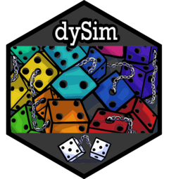

<!-- README.md is generated from README.Rmd. Please edit that file -->

```{r, include = FALSE}
knitr::opts_chunk$set(
  collapse = TRUE,
  comment = "#>",
  fig.path = "man/figures/README-",
  out.width = "100%"
)
```

# dySim <a href="https://jsakaluk.github.io/dySim/"></a>

<!-- badges: start -->
[](https://lifecycle.r-lib.org/articles/stages.html#experimental)
[](https://github.com/jsakaluk/dySim/actions/workflows/R-CMD-check.yaml)
<!-- badges: end -->

The goal of `dySim` is to simplify the process of running a variety of Monte Carlo simulations for the purpose of evaluating methods of dyadic data analysis. `dySim` piggybacks heavily on the `lavaan` and `dySEM` packages. 

The `dySim` logo was designed by the *amazing* Lowell Deranleau (for logo design inquiries, email: agangofwolves@gmail.com).

## Installation

You can install the development version of dySim from [GitHub](https://github.com/) with:

``` r
# install.packages("devtools")
devtools::install_github("jsakaluk/dySim")
```

## Development Update

After laying dormant, I have recently started development on `dySim` again. It is being brought into alignment with the current (and rapidly growing) functionality of `dySEM`. I am intending `dySim` to support simulations of:

- parameter estimation bias, accuracy, and coverage
- statistical power and sample size planning
- model evaluation and selection

Would-be users should expect large changes to the API and functionality in the near future. I will be updating the documentation and vignettes as I go, but for now, please reach out if you have questions about how to use `dySim` or if you have suggestions for features to add.

## Collaboration and Troubleshooting

Please submit any problems or feature requests via the `dySim` [issues](https://github.com/jsakaluk/dySim/issues) page.

If you are interested in collaborating on the development of `dySim`, please contact Dr. Sakaluk. 


